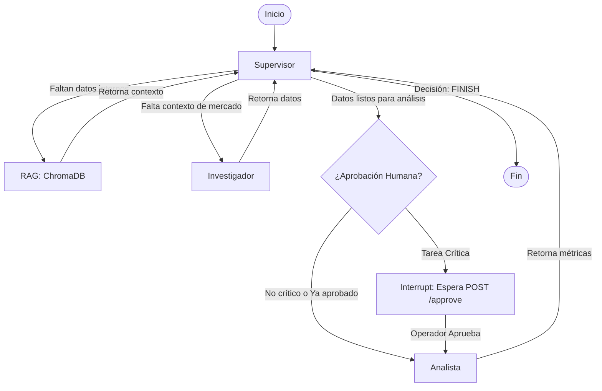

# Entrega final: Intelligence System (RAG + Multi-Agentes)

Proyecto integrador final para Coderhouse. Consiste en un **Sistema de Inteligencia de grado de producción** que combina **RAG (Retrieval-Augmented Generation)**, orquestación de **agentes autónomos (LangGraph)** con un Supervisor, una **API asíncrona (FastAPI)**, persistencia de estado en **Redis**, interacción **Human-in-the-Loop (HITL)** y observabilidad completa con **Arize Phoenix**.

---

## Consigna y Requerimientos de la Entrega

### Objetivo
Construir un **Sistema de Inteligencia de grado de producción** (The Intelligence System) que unifique las capas desarrolladas a lo largo del curso. El sistema debe ser capaz de resolver tareas complejas combinando el acceso a conocimiento específico (vía **RAG**), el razonamiento multi-paso (vía **Agentes con Supervisor**), una interfaz asíncrona profesional (**FastAPI**) y trazabilidad completa de su ejecución interna (**Arize Phoenix**).

### Requerimientos Técnicos Cumplidos(Alineados a la Rúbrica)

**1. Arquitectura y Coherencia.**
   - **Integración Unificada:** Estructura de proyecto profesional (Python 3.12+) que consolida el orquestador multi-agente, la base vectorial y la API en un solo repositorio.
   - **RAG Implementado:** Uso de `ChromaDB` como base de datos vectorial local. El grafo incluye un nodo `Retriever` que inyecta contexto de documentos internos antes de que los agentes razonen, reduciendo alucinaciones.
   - **Orquestación Jerárquica:** Un nodo `Supervisor` decide dinámicamente si delegar al `Retriever`, al `Investigador` o al `Analista`, con un límite estricto de iteraciones para evitar bucles infinitos.

**2. Robustez Técnica y Asincronía.**
   - **Endpoints No Bloqueantes:** `POST /tasks` encola el trabajo y devuelve un `job_id` (HTTP 202) al instante. El polling se realiza vía `GET /tasks/{id}`.
   - **Cola Asíncrona Durable:** Sustitución de `BackgroundTasks` por una `asyncio.Queue` interna gestionada por un Worker. Esto permite encolar tareas sin perderlas y controlar el Rate Limit del LLM (`Semaphore(1)` + cooldown).
   - **Validación con Pydantic:** Uso estricto de modelos Pydantic para validar las entradas/salidas de la API (`TaskRequest`, `ApprovalRequest`) y las herramientas de los agentes.

**3. Persistencia y Observabilidad.**
   - **Checkpointer en Redis:** Uso de `AsyncRedisSaver` de LangGraph. El estado de las conversaciones y las pausas sobreviven a reinicios del servidor. Si ocurre una excepción, el estado del trabajo se actualiza a `FAILED` en Redis.
   - **Trazabilidad Completa:** Instrumentación con OpenTelemetry y Arize Phoenix. Se adjuntan en `/screenshots` las capturas de al menos **5 pruebas de punta a punta**, demostrando el árbol de spans, los tokens consumidos y el costo por ejecución.

**4. Human-in-the-Loop (HITL) y Flujo de Trabajo**
   - **Pausa Determinista:** Si una tarea requiere análisis crítico (`critical: true`), el grafo se detiene en el nodo `AprobacionHumana` mediante `interrupt()`.
   - **Reanudación Segura:** El endpoint `POST /tasks/{id}/approve` envía una señal `Command(resume=...)` que reanuda el grafo exactamente desde el punto de pausa guardado en Redis.


---

## Arquitectura y Flujo del Grafo (Mermaid)

El sistema utiliza una cola asíncrona (`asyncio.Queue`) para procesar los trabajos en segundo plano. El grafo cuenta con un Supervisor que delega tareas a un **Retriever** (búsqueda en base vectorial), un **Investigador** y un **Analista**, con una pausa obligatoria para tareas críticas.


---
## Estructura del Repositorio 
```
intelligence-system/
	├── app/
	│   ├── main.py            # Endpoints FastAPI (Lifespan + Encolado)
	│   ├── queue_worker.py    # Consumidor de la cola asíncrona y control de Rate Limit
	│   ├── graph.py           # Grafo LangGraph (Supervisor, Retriever, HITL, etc.)
	│   ├── rag.py             # Configuración de ChromaDB y Embeddings
	│   ├── observability.py   # Instrumentación de Arize Phoenix
	│   ├── state.py           # Esquema del TeamState (Pydantic/TypedDict)
	│   └── config.py          # Configuración de LLM (Gemini, OpenAI, Groq)
	├── screenshots/           # Evidencia visual de trazas, tokens y consola HITL
	├── ingest_data.py         # Script para popular la base vectorial (RAG)
	├── test_api.py            # Suite de tests unitarios (Pytest + httpx)
	├── test_concurrency.py    # Script de prueba de carga (5 peticiones)
	├── pytest.ini             # Configuración de Pytest (event loop)
	├── requirements.txt       # Dependencias del proyecto
	├── docker-compose.yml     # Orquestación (API + Redis + Phoenix)
	├── .env.example           # Plantilla de variables de entorno
	├── .gitignore             # Exclusión de archivos temporales y secretos
	└── README.md              # Documentación
```
---

## Pasos a seguir:
**Pasos para Inicializar el Proyecto** 

**1. Configuración Inicial**

	Renombrar archivo .env.example a .env y configurá las claves
	LLM_PROVIDER=gemini
	GOOGLE_API_KEY=tu_api_key_aqui
	TAVILY_API_KEY=tu_api_key_aqui
	
**2. Despliegue con Docker Compose**
	
	docker-compose up --build
	API REST (FastAPI): http://localhost:8000
	Dashboard Arize Phoenix: http://localhost:6006

**3. Cargar la Base de Conocimiento (RAG)**	
	
	docker exec -it api_agente python ingest_data.py
	API REST (FastAPI): http://localhost:8000/docs
	Dashboard Arize Phoenix: http://localhost:6006

**4. Ejecutar la Suite de Tests**
	
	docker exec -it api_agente pip install pytest pytest-asyncio
	docker exec -it api_agente python -m pytest test_api.py -v

**Ejecución Local en Entorno Virtual**	
1. **Iniciar el servidor de Redis:**	
	  
		docker run -d -p 6379:6379 --name redis_agente redis/redis-stack-server:latest
	
2. **Crear y activar entorno virtual:**

   		python -m venv venv
	 	 venv\Scripts\activate    
	
4. **Instalar dependencias de requirements.txt:**

   		pip install -r requirements.txt
	
6. **Cargar la base de conocimiento (RAG)**

   		python ingest_data.py

8. **Iniciar la API FastAPI:** 

   		-- uvicorn app.main:app --host 0.0.0.0 --port 8000 --reload
	
**Guía de Uso de los Endpoints(Windows PowerShell)**
1. **Crear una nueva tarea (POST /tasks)**

   		$body = '{"query": "¿Qué dice el manual interno sobre el stack tecnológico?", "critical": false}'
	  	$resp = Invoke-RestMethod -Uri "http://localhost:8000/tasks" -Method Post -ContentType "application/json" -Body $body
	  	$resp
		 
3. **Consultar el estado del trabajo (GET /tasks/{job_id})**

   		$jobId = $resp.job_id # Reemplazar por tu ID real si es otra sesión
	  	Invoke-RestMethod -Uri "http://localhost:8000/tasks/$jobId" -Method Get
	
5. **Aprobar una tarea pausada por HITL (POST /tasks/{job_id}/approve)**

   	 	Para que esto funcione, la tarea debe haberse creado con "critical": true
	  	$appr = '{"approved": true, "reason": "Aprobación del operador"}'
	 	Invoke-RestMethod -Uri "http://localhost:8000/tasks/$jobId/approve" -Method Post -ContentType "application/json" -Body $appr
	 
**Prueba de Carga y Concurrencia (5 Peticiones Simultáneas)**
	  
	  	python test_concurrency.py
